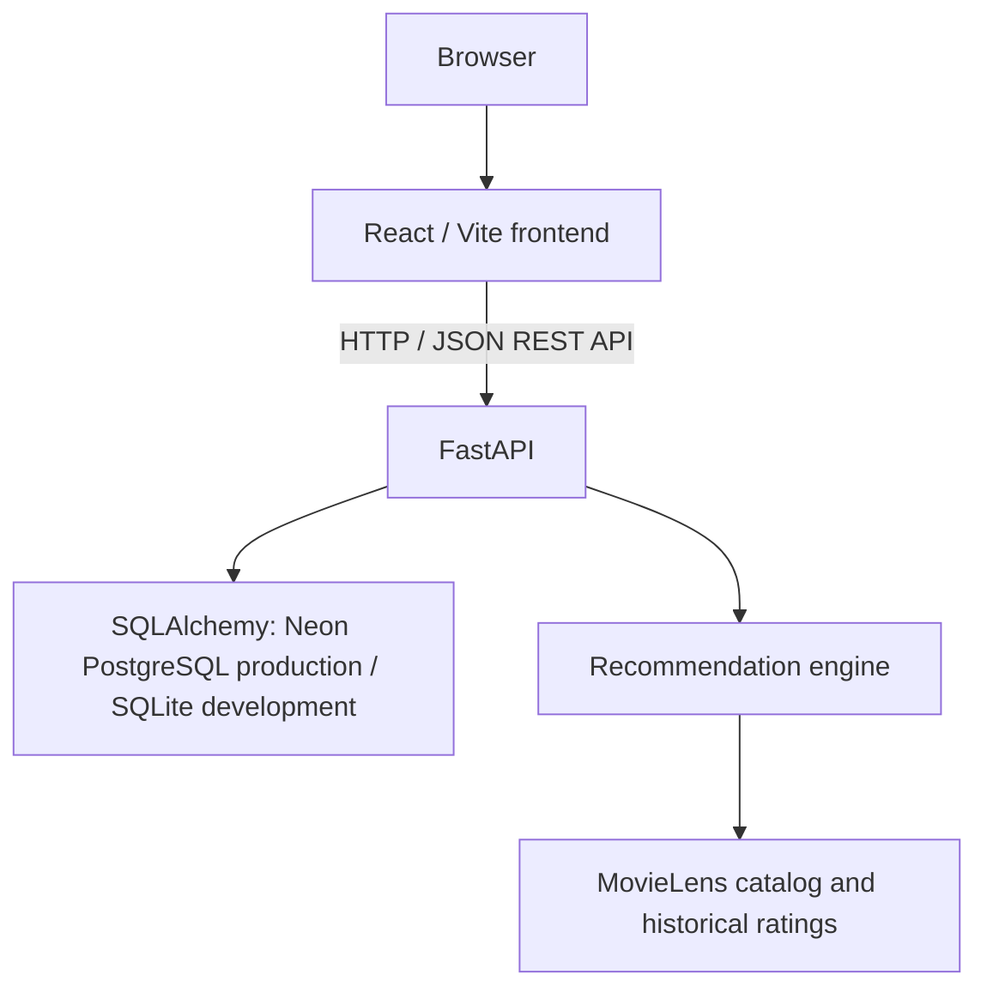

# Movelle

A portfolio movie recommender: React/Vite/Tailwind on Vercel, FastAPI on Azure Container Apps, Neon PostgreSQL for application profiles, and read-only prepared MovieLens 32M reference arrays. Local development uses SQLite. GHCR and GitHub Actions provide manually controlled releases with Azure OIDC.

The scoring mathematics remains unchanged. Production boundaries now require anonymous profile credentials, explicit group invitations, bounded workloads, and versioned migrations. See [deployment and rollback](docs/DEPLOYMENT.md), [audit resolution](docs/AUDIT_RESOLUTION.md), and [recommendation evidence](docs/RECOMMENDATIONS.md).

The planned Supabase authentication launch is governed by the
[architecture contract and open validation gates](docs/AUTH_ARCHITECTURE.md).
The approved launch design uses optional standard TOTP with a second independent
TOTP factor for backup recovery. Native MFA recovery codes are rejected for initial
launch; Gmail SMTP production readiness remains open. Supabase auth is not active on application routes.
Schema version 3 adds dormant UUID/username identity mappings without changing legacy
credentials, numeric IDs or ratings; no user linking or Supabase login runs yet.
The standalone JWT verifier and existing-link identity resolver are dormant and grant no application access;
[JWT verification limits](docs/AUTH_ARCHITECTURE.md#prompt-3a-dormant-jwt-verifier) apply to later integration.
Read the [identity-resolution trust boundary](docs/AUTH_ARCHITECTURE.md#prompt-3b-dormant-identity-resolution)
before future route integration; UUID type checking is not proof of authentication.
The [dormant FastAPI dependency](docs/AUTH_ARCHITECTURE.md#prompt-3c-dormant-fastapi-dependency-activation-blocked)
composes these foundations only in tests; protected-route activation remains blocked on security-policy review.
See the [standard Supabase policy](docs/AUTH_POLICY_EVIDENCE.md): native email
confirmation, bounded JWT validity after logout, and optional TOTP. Public signup
and anonymous browsing are planned; personal features require backend ownership
checks. No independent mailbox ledger, custom Auth database reader, immediate
revocation guarantee or legacy-account migration is required. Production remains
unchanged; [Prompt 12 native signup confirmation](docs/SIGNUP_CONFIRMATION.md)
is implemented as a dormant helper. The full NIST assessment and original 16-stage
audit remain required before launch.

## Local development

Use Python 3.14 and Node.js 24 (>=22.12 supported by the frontend tools). Install the Python dependencies once, from the repository root:

```powershell
python -m venv .venv
.\.venv\Scripts\python.exe -m pip install --require-hashes -r requirements-dev.txt
```

Then, from `frontend/`, run `npm ci` and `npm run dev`. Stop an older frontend-only Vite process first. Open the exact URL on the launcher's **READY** line (normally http://127.0.0.1:5173). This command prepares/verifies the bundled MovieLens sample, starts FastAPI on loopback port 8000, verifies health and database readiness, then starts Vite and verifies its proxied readiness and decade JSON before printing READY. Ctrl+C stops both services. It deliberately uses a persistent, ignored `.movelle-dev/application.db` SQLite database and `.movelle-dev/prepared/`, overriding inherited cloud/database settings **in its child processes only**. Production build configuration is unchanged. It prepares MovieLens data offline and never contacts Movelle production services. Optional enrichment uses Trakt metadata and Fanart.tv artwork when their server credentials are configured. Existing development data is not overwritten. On Linux/macOS use `.venv/bin/python` for setup.

`npm run dev -- --port 5174` selects a different frontend port. Set `MOVELLE_DEV_API_PORT` in that terminal to choose a different local API port; the launcher supplies the matching proxy target. `MOVELLE_DEV_PYTHON` can select another Python executable with the required dependencies installed. The launcher refuses occupied frontend and API ports before starting either service. It never reuses or stops unknown services. `MOVELLE_DEV_INSTANCE` optionally selects a separate database under `.movelle-dev/instances/<name>/application.db`; only letters, numbers, underscores and hyphens are accepted.

For an independently managed backend, `npm run dev:frontend` starts **only Vite**. Its same-origin `/api` proxy defaults to `http://127.0.0.1:8000`; `API_PROXY_TARGET` is an optional **server-only, loopback HTTP(S) origin** loaded by Vite. It must not contain credentials, paths, or query parameters. Restart Vite after changing its environment. This mode requires you to start and verify the API separately. A missing API returns an actionable HTTP 502; it is not replaced by sample response data. `VITE_API_BASE_URL` is a public build-time setting for direct API access, normally unset in this manual local mode. A direct cross-origin URL requires intentionally configured backend CORS; the local proxy requires no CORS relaxation. Never put secrets into `VITE_*`.

To manage the API yourself, prepare a new output directory with `python scripts/prepare_movielens.py --source data --output data/prepared/latest-small-v1`, set `APP_ENV=development` and `MOVIELENS_PREPARED_DIR` to that output, and run `python -m app.runtime`. Preparation refuses an existing output directory; verify it with `python scripts/prepare_movielens.py --verify PATH` before reusing it. Select an explicit local SQLite `DATABASE_URL` for isolated QA. These manual API commands are unnecessary when using the default `npm run dev` launcher.

For 32M, run `python scripts/load_movielens.py --dataset ml-32m --download`, then `python scripts/prepare_movielens.py --source data/raw/ml-32m --output data/prepared/ml-32m-v1 --dataset ml-32m`, and select that prepared directory. Acquisition and preparation are offline/operator tools, never public endpoints. Retain the upstream README/license. There is no implicit Small fallback.

Direct `python -m uvicorn app.main:app --reload --no-access-log` is supported for development. Both entrypoints verify artifact inventory/checksums; neither runs the full semantic profile/posting scan at startup. Explicit offline verification: `python scripts/prepare_movielens.py --verify PATH`.

## Film metadata and imagery

Movelle uses **Trakt** for film metadata and **Fanart.tv** with a cached **Trakt** fallback for posters/backdrops. Enrichment is display-only: canonical MovieLens IDs, historical ratings and the recommendation algorithm are unchanged. No Trakt user login or client secret is required. The backend reads `TRAKT_CLIENT_ID` and `FANART_API_KEY` (the Fanart.tv project key); neither belongs in `VITE_*` or the browser bundle. Existing Windows terminals may need these specific user variables loaded before startup:

```powershell
$env:TRAKT_CLIENT_ID = [Environment]::GetEnvironmentVariable('TRAKT_CLIENT_ID', 'User')
$env:FANART_API_KEY = [Environment]::GetEnvironmentVariable('FANART_API_KEY', 'User')
npm run dev
```

The combined launcher detects a matching MovieLens `links.csv` with sibling `movies.csv`; `MOVELLE_ARTWORK_LINKS` can select another matching pair. The image bundles a checksum-bound IMDb companion for the verified 32M catalogue; custom/small catalogues can provide matching links explicitly. Verified IMDb IDs take priority, including series resolved through Trakt/TVDB. Without links, only an unambiguous normalized title/alternate-title and exact release-year match is accepted, followed by a Trakt summary check. Wrong IDs, remakes, ambiguous matches and unknown artwork remain unavailable rather than receiving unrelated images.

The catalogue-only `POST /movies/artwork` accepts 1-8 canonical IDs and selected display fields, never arbitrary provider URLs or identifiers. It has additional shared-database quotas of 40 requests/minute/source address and 180/minute globally, alongside general admission. Provider HTTP concurrency is capped at three, with deadlines, one bounded transient retry, rate-limit cooldowns and a conservative 200-request/provider/process/five-minute budget. Metadata and artwork are deduplicated and cached for seven days (missing records six hours); credentials are never cached. Stale public records can cover outages for up to 30 days from fetch. Expired records are removed on access; operators should periodically retire unused cache storage. Director credits load only when film details open.

`MOVELLE_ARTWORK_CACHE_DIR` holds a new `trakt-fanart-v2` namespace; retired provider cache files are never read or converted. New processes without the relevant provider keys do not serve that provider's cache. No retired-provider API, CDN, credential or logo is used by the application. The browser tries Fanart posters, cached Trakt posters, Fanart backgrounds, then cached Trakt backgrounds. Background covers are labeled Film still. Fanart uses approved `https://assets.fanart.tv` previews; Trakt WebP bytes are cached and served by the canonical-ID-only Movelle image endpoint, never hotlinked. Server downloads have strict host/path and public-IP validation, no redirects, MIME/size/time limits, concurrency and bounded memory/disk caching. See [artwork setup](docs/ARTWORK.md) for regeneration and limits. No profile credential or provider key is sent with browser CDN requests.

**Optional personal Fanart.tv key:** Profile ? Artwork access. Ordinary access uses the application project key without requiring a personal key. A profile owner may enter a masked personal key for the current tab. It goes only in a same-application HTTPS JSON request, then a server-to-Fanart.tv `client-key` header alongside `api-key`. It is never a URL parameter, local/session storage entry, database record, log message or disk-cache field. Remove it with **Remove personal key**; reload or profile change also clears it. Personal-tier metadata is held separately in bounded memory for at most ten minutes and is never shared with ordinary access or persisted. The interface confirms key format, not provider acceptance. Same-origin script access remains a browser-memory risk; the key cannot be hidden from its owner's own developer tools.

Credits identify and link both providers and disclaim endorsement. Film details preserve recorded image copyright/source information, including unknown holders. Source links are attribution only, never fetched for enrichment. API access does not transfer image copyright. Keep this deployment free/noncommercial; commercial Fanart.tv use requires written consent. The project owner must keep their Fanart.tv account email current and verify the current API registration terms before public rollout. See [provider setup and policy notes](docs/ARTWORK.md), [Trakt API policy](https://developer.trakt.tv/docs/api-use-policy), [Fanart.tv API documentation](https://api.fanart.tv/), and [image terms](https://fanart.tv/terms-and-conditions/). MovieLens licensing is separate.

## Interface and local preferences

Discover, My ratings, For you, and Groups share film details, search, genre/decade controls, and responsive poster layouts. The header Theme control previews seven dark palettes, including grayscale with off-white text. Preferences are saved locally in `movelle.theme.v1`, independently of profile credentials, and synchronize across tabs. If storage is unavailable, a theme still applies for the visit. Keyboard focus, native dialogs and reduced-motion preferences are supported.

Fonts are served locally with their SIL Open Font License files in `frontend/public/fonts/`. Film images remain provider content; they are not bundled or represented as owned by Movelle.

## Local troubleshooting

- Use the exact READY URL. For isolated concurrent review, set `MOVELLE_DEV_API_PORT` and `MOVELLE_DEV_INSTANCE`, then choose a different Vite `--port`. An occupied port is an error; the launcher never takes over another process.
- Verify `/api/health`, `/api/ready`, and `/api/movies/decades` through that frontend origin. A 502 indicates an unavailable local API; restart the owning launcher or correct the manual proxy target. `/ready` verifies initialization and database connectivity, not just HTTP liveness.
- Profiles belong to their issuing database. Keep recovery codes private and use disposable local profiles for QA rather than production credentials.
- If artwork is unavailable, check the server-only Trakt/Fanart.tv keys, writable cache, matching links CSV, and provider availability. Missing or ambiguous matches are intentionally left without artwork. The Vercel image policy permits same-origin/data images, `https://assets.fanart.tv`, and the exact existing Azure API origin for cached images.

A future release needs a compatible frontend and backend, public `VITE_API_BASE_URL`, appropriate backend CORS, and server-side Trakt/Fanart.tv key and cache configuration. The token is never a frontend setting. Changes here do not initiate or authorize a production rollout.

## Anonymous identity and groups

`POST /users` issues an ID, a random 256-bit bearer credential, and an expiration timestamp (one year). Only SHA-256 hashes of these high-entropy credentials are stored. IDs alone grant no profile access. Profile GETs, ratings, and personalized recommendations require `Authorization: Bearer CREDENTIAL`. Responses containing private data use `Cache-Control: no-store`.

Request-validation errors return only fixed `type`, sanitized `loc`, and fixed `msg` diagnostics. Submitted inputs, validator context, custom messages, and dynamic mapping keys are not serialized. The supported runtime and combined local launcher disable Uvicorn access logging because raw URLs can contain mistakenly pasted credentials. Operators must separately check ingress/platform logging; never log authorization headers, recovery codes, invitation bodies, or full credential-bearing URLs.

The browser stores the credential in localStorage, restores it after refresh, and reacts to identity changes in other tabs. Save the masked **private recovery code** securely before replacing a profile or clearing browser storage. Anyone holding it owns the profile. No email/password account or automatic lost-key recovery is implied. LocalStorage is accessible to same-origin scripts; React text rendering, restricted scripts, dependency updates, and the Vercel CSP reduce risk but do not make stolen credentials harmless.

Groups include the caller plus one to four consenting members. Each other member creates a ten-minute `ID:invitation` code with `POST /users/{id}/group-invitation`. Supply `user_ids` and an `invitations` map to `POST /recommendations/group`. These capabilities grant group computation only, not raw ratings or writes. Creating another invitation invalidates the previous one; DELETE on the invitation endpoint revokes it. Never share a private recovery code for a group.

Legacy users/ratings are preserved by additive migrations and locked because old numeric IDs cannot prove ownership. Only an operator with independently verified ownership may use `python -m app.manage recover-profile --user-id ID --output PRIVATE_PATH.credentials.json`. The command refuses active claimed profiles, supports expired credentials, and writes the new credential to a private new file instead of stdout. Protect Windows file ACLs and transfer that file privately. If ownership cannot be verified, create a new profile; do not publicly claim an old ID.

## Public API resource policy

| Protection | Default |
|---|---|
| Body / receive deadline | 16 KiB / 10 seconds, including chunked bodies |
| Search / genre input | 120 / 40 characters |
| General API admission | 180 requests/minute/source address; 600/minute globally |
| New profiles | 10/hour/source address; 1,000/day globally; 5,000 profiles total |
| Rating writes | 60/minute/profile; at most 100 distinct saved ratings |
| Group invitation issuance | 10/minute/profile |
| Personal/group computation | 6/minute/caller; 30/minute globally |
| Group workload | At most 5 members and 200 distinct combined ratings |
| Compute admission | One personal/group operation/process; immediate 503 + Retry-After when busy |
| Compute deadline | Cooperative 20-second budget; no detached work after timeout |
| DB pool | Two connections/replica, no overflow; three-second checkout wait |
| PostgreSQL budgets | Five-second statements, two-second locks, ten-second idle/overall transactions (server overall timeout on PostgreSQL >=17) |

Admission counters live in the shared database and expire independently of profiles. Counter cleanup deletes only old counters; no automatic deletion of users/ratings occurs. A serialized lifetime cap of 5,000 profiles bounds long-term growth; raising it requires an operator storage-budget review. Rate windows use the database clock and cannot rewind. Failed endpoint transactions may roll back their owner counter, while the separately committed public admission remains charged. These controls bound normal application abuse; platform ingress and finite replica/cost limits remain necessary for volumetric attacks.

Do not trust client-supplied forwarding headers. `TRUSTED_PROXY_IPS` defaults to empty. Configure only validated ingress proxy addresses/CIDRs; never `*`. Without that configuration an ingress proxy may share a conservative source quota across visitors. Verify this with two real client networks before promotion.

Legacy profiles above the new rating quota remain readable/paginated and existing ratings remain updateable; personalization rejects profiles above 100 rather than silently sampling or deleting their data. Group requests over the union limit fail with an actionable 422.

Ratings metadata is returned in one bounded request: `GET /users/{id}/ratings/details?limit=100&after=MOVIE_ID` gives `items`, `next_after`, and `total`. Unavailable catalog entries retain their rating and display an unavailable label. Search uses one bounded rating lookup for its results. The original ratings list remains available, now keyset-paginated (default/max 100).

The frontend preserves HTTP status/Retry-After, times out requests after 45 seconds, and retries only explicit recommendation-capacity failures up to twice with jitter. It never automatically retries profile creation or rating writes. A timed-out write may have committed: use **Reload saved ratings** before retrying.

## Configuration

| Variable | Meaning |
|---|---|
| `APP_ENV` | `development` locally; image defaults to `production`. Unknown modes fail. |
| `DATABASE_URL` | Backend secret. Production requires PostgreSQL with `sslmode=require`, `verify-ca`, or `verify-full`; prefer certificate verification supported by your Neon connection. Missing configuration never falls back to SQLite in production. |
| `CORS_ALLOWED_ORIGINS` | Exact comma-separated origins, no paths/trailing slash/wildcards. Production requires HTTPS origins. Authorization is independently enforced. |
| `VITE_API_BASE_URL` | Public backend HTTPS origin, no `/api`; set at frontend build time. Never put a secret in `VITE_*`. Unset means development `/api` proxy; Vercel must supply the real backend origin. The default local launcher explicitly uses `/api` in its Vite child. |
| `API_PROXY_TARGET` | Manual frontend-only development: loopback HTTP(S) API origin, default `http://127.0.0.1:8000`. Server-only; never bundled as browser configuration. |
| `MOVELLE_DEV_API_PORT` | Default local launcher only: API port, default 8000. The launcher configures its matching Vite proxy. |
| `MOVELLE_DEV_INSTANCE` | Optional local database namespace; useful for isolated browser QA. |
| `MOVELLE_DEV_PYTHON` | Default local launcher only: optional Python executable; otherwise uses the repository `.venv`. |
| `TRAKT_CLIENT_ID` | Server-only Trakt application client ID for public metadata. No OAuth or client secret required. |
| `FANART_API_KEY` | Server-only Fanart.tv project API key. Personal keys are optional tab-only user inputs, not deployment variables. |
| `MOVELLE_ARTWORK_LINKS` | Optional MovieLens links CSV with sibling movies CSV for verified canonical image matching. |
| `MOVELLE_ARTWORK_CACHE_DIR` | Optional writable public metadata cache; local launcher defaults to `.movelle-dev/artwork`. |
| `MOVIELENS_PREPARED_DIR` | Prepared reference directory. Image default `/backend/data/reference/ml-32m-v1`. |
| `MOVIELENS_ARCHIVE_URL` / `MOVIELENS_ARCHIVE_SHA256` | Both required for opt-in pinned bootstrap; omit both for administrator-mounted artifacts. |
| `TRUSTED_PROXY_IPS` | Explicit trusted forwarding proxies; empty is conservative, wildcard is rejected in production. |
| `PORT` | Backend port, default 8000. |
| `POSTGRES_TEST_URL` | Tests only; rejected unless an explicit disposable loopback PostgreSQL destination. Never use Neon here. |
| `MOVIELENS_32M_EQUIVALENCE` | Opt-in local read-only 32M equivalence/profile regressions. |

Pinned prepared release: `https://github.com/aanxnd/movie-recommender/releases/download/data-v1/ml-32m-v1.tar.gz`, SHA-256 `1e7fc9d6c664cff0f697438996e31ed6cf40cd7570aee43e31b814f0e505c303`. Reusing downloaded data requires the same pinned provenance and unchanged files. A changed hash or missing provenance fails safely: choose a fresh versioned directory. Mounted data is verified against its manifest. Startup never relabels old data as a different release.

## Migrations and operations

`python -m app.manage migrate` runs additive, versioned migrations under a PostgreSQL transaction advisory lock or SQLite BEGIN IMMEDIATE. Version 1 adds ownership/invitations/schema tracking; version 2 adds admission counters; version 3 adds optional identity mappings. No existing ratings are removed. Development migrates automatically; production only checks the required schema. Older schema-2 binaries reject schema 3; follow the [compatible rollback strategy](docs/DEPLOYMENT.md#rollback).

`/health` is cheap liveness. `/ready` checks initialization plus a single-flight, deadline-bounded database probe: success is cached 30 seconds, failure two seconds. Concurrent callers share the result. Probe subprocess isolation/termination remains to bound stalled database drivers, but requests no longer spawn a process each time. Readiness can lag a database failure by the cache interval; it is not a check of every application write permission or a guarantee of spare recommendation capacity.

The image is non-root (UID 10001), contains runtime-only dependencies, uses one Uvicorn worker, limits concurrent connections, and has a 30-second graceful shutdown budget. Set a longer platform termination grace. Use disk-backed prepared storage, approximately 2 GiB RAM and 2 GiB writable disk as an initial allocation, then measure. Each fresh ephemeral replica may download the archive; startup probes must tolerate that delay. Multiple replicas have separate memory/gates but share PostgreSQL quotas.

## Verification and dependency maintenance

```powershell
.\.venv\Scripts\python.exe -m pytest -q -p no:cacheprovider
cd frontend
npm test
npm run test:dev
npm run test:browser
npm run build
```

`npm run test:dev` checks real port conflicts and shutdown on owned API failure using ports 5181/8011. `npm run test:browser` uses installed Chrome in a fresh headless context and owns ports 5180/8010 with a fresh isolated SQLite instance per run. It never uses a personal browser profile. Masked screenshots are written to `docs/screenshots/movelle/`; traces and videos are disabled to keep recovery and invitation codes out of artifacts. Screenshots are local review artifacts and are excluded from Git. Set `MOVELLE_SCREENSHOT_DIR` to an absolute directory to save a run separately from existing review captures. Live poster checks require `TRAKT_CLIENT_ID` and `FANART_API_KEY` in the server process. Personal-key browser tests intercept synthetic keys locally rather than submitting fabricated credentials to the provider.

For a disposable localhost PostgreSQL server set `POSTGRES_TEST_URL` only in the test process. CI provisions its own PostgreSQL 17 container. Optional 32M tests read existing local prepared files and never call production services. `scripts/smoke_container.py --image IMAGE --prepared PATH` starts/stops only a newly created disposable container and verifies readiness, ownership, persistence contract, recommendations, UID, and absence of pytest/HTTPX.

Runtime/test Python dependencies are pinned separately with published distribution hashes. CI and Docker enforce hashes; Docker accepts wheels only. After deliberately selecting reviewed versions, run `python scripts/hash_requirements.py`, reinstall the dev lock, rerun advisory checks and regressions, and rebuild. npm uses `npm ci`; actions, the Python base image, and the CI PostgreSQL image are digest/commit-pinned. Dependabot proposes upgrades. Check both runtime and development advisories; the latter still matter for contributors/builds.

## How It Works



Prepare MovieLens 32M offline, or explicitly bootstrap the pinned prepared release before starting FastAPI. Startup memory-maps read-only numeric profile arrays, movie-to-user postings, precomputed statistics, and catalog metadata. These reference users remain separate from application users, whose ratings are stored through SQLAlchemy in Neon PostgreSQL (production) or `data/application.db` (development). Both databases enforce movie references.

The personalized pipeline in [app/recommender.py](app/recommender.py) works as follows:

1. **Find similar users.** Pearson correlation compares ratings on shared movies, centered around each shared profile's mean. Insufficient overlap or effectively zero variance gives zero similarity. Positive correlations are weighted by `overlap / (overlap + 10)` before selecting up to 15 neighbors, so perfect correlations from two shared movies do not dominate better-supported matches.
2. **Predict unseen movies.** Start with the target's overall mean and calculate a weighted average of contributing neighbors' deviations from their own overall means. Adjusted similarities also determine candidate evidence `E`, with overlap evidence scaling up to five shared movies. Multiply the CF deviation by `E / (E + 5)` before adding it to the target mean and bounding the prediction to 0.5–5.0. Only neighbors who rated that movie contribute; already-rated movies are excluded.
3. **Add a secondary genre signal.** Ratings above or below the target's mean indicate relative genre preferences. Sparse genre evidence is shrunk toward neutral, then used for a small, bounded adjustment scaled by recommendation confidence. Genre matching alone cannot create an unsupported prediction.
4. **Rank with evidence.** Confidence is `E / (E + 3)`: a supporting-evidence heuristic, **not a calibrated probability or guarantee of accuracy**. Ranking shrinks the genre-adjusted prediction toward the historical global mean according to confidence. The interface displays the bounded prediction and confidence; the internal ranking score determines order.

No LensKit recommender is used. Pearson similarity, neighbor selection, prediction, confidence, and ranking are implemented here.

With fewer than two ratings, or no usable collaborative-filtering candidates, the engine falls back to historical average ratings from movies meeting a configurable minimum rating count (20 by default). Popular and genre recommendations use this same average-and-count approach. Fallback results are labeled as historical averages and carry no CF confidence; short personalized lists are not padded with popularity results.

Decade selection restricts candidates before ranking and limiting, including fallback candidates. Release years come from trailing years in MovieLens titles; movies with unknown years are excluded when a decade is selected. Groups average the supplied ratings for each movie, preserve ratings supplied by only one member, and run the same pipeline while excluding movies rated by any member. This simple combination can hide disagreements between members.


## Data and evaluation

The tracked MovieLens Small snapshot is retained for deterministic offline tests. Production reference data is MovieLens 32M; application-created users never become historical reference users. Data archives, prepared arrays, databases, credentials, and evaluation outputs are excluded from version control and the image.

The original deterministic offline evaluation remains in `scripts/evaluate_recommender.py`. Follow train, validation, select, test phases with a fresh output directory; do not retune against test results. Sparse confidence is evidence, not probability. The reported eight-film scenario and exact baseline timing/output comparisons are recorded in [the recommendation investigation](docs/RECOMMENDATIONS.md).

Dataset citation: F. Maxwell Harper and Joseph A. Konstan (2015), *The MovieLens Datasets: History and Context*, ACM TiiS 5(4), Article 19, https://doi.org/10.1145/2827872. Follow the usage conditions in the upstream [README](data/README.txt), including restrictions on commercial use.

The official [Small license](https://files.grouplens.org/datasets/movielens/ml-latest-small-README.html) and [32M license](https://files.grouplens.org/datasets/movielens/ml-32m-README.html) permit research use subject to attribution, no implied endorsement, and the same conditions on redistributed data or transformations. Commercial or revenue-bearing use requires faculty permission. The [dataset site](https://grouplens.org/datasets/movielens/) also says public redistribution is typically not permitted and provides a permission-request form. Obtain clarification for a public portfolio and its downloadable Small files/prepared 32M release; do not assume an educational label or LinkedIn promotion resolves the scope. Preserve the upstream license with every prepared distribution. Neither GroupLens nor the University of Minnesota endorses Movelle.
