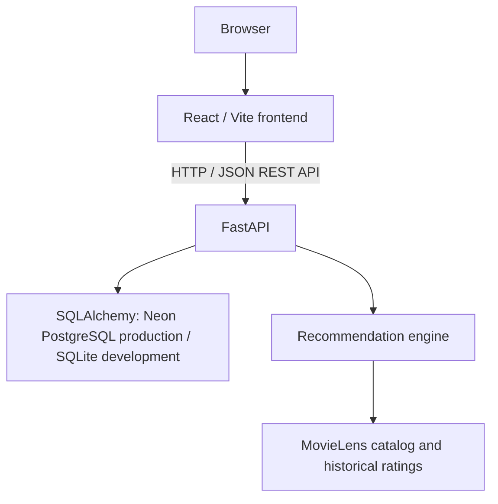

# Movelle

A portfolio movie recommender: React/Vite/Tailwind on Vercel, FastAPI on Azure Container Apps, Neon PostgreSQL for application profiles, and read-only prepared MovieLens 32M reference arrays. Local development uses SQLite. GHCR and GitHub Actions provide manually controlled releases with Azure OIDC.

The scoring mathematics remains unchanged. Production boundaries now require anonymous profile credentials, explicit group invitations, bounded workloads, and versioned migrations. See [deployment and rollback](docs/DEPLOYMENT.md), [audit resolution](docs/AUDIT_RESOLUTION.md), and [recommendation evidence](docs/RECOMMENDATIONS.md).

## Local development

Use Python 3.14 and Node.js 24 (>=22.12 supported by the frontend tools). PowerShell, from the repository root:

```powershell
python -m venv .venv
.\.venv\Scripts\python.exe -m pip install --require-hashes -r requirements-dev.txt
.\.venv\Scripts\python.exe scripts/prepare_movielens.py --source data --output data/prepared/latest-small-v1
$env:APP_ENV = 'development'
$env:MOVIELENS_PREPARED_DIR = 'data/prepared/latest-small-v1'
.\.venv\Scripts\python.exe -m app.runtime
```

Preparation refuses to overwrite an existing directory: skip that command if it already exists and is verified. In a second terminal run `cd frontend`, `npm ci`, and `npm run dev`. Open http://127.0.0.1:5173. Vite proxies `/api` to port 8000. On Linux/macOS use `.venv/bin/python` and `export NAME=value`.

For 32M, run `python scripts/load_movielens.py --dataset ml-32m --download`, then `python scripts/prepare_movielens.py --source data/raw/ml-32m --output data/prepared/ml-32m-v1 --dataset ml-32m`, and select that prepared directory. Acquisition and preparation are offline/operator tools, never public endpoints. Retain the upstream README/license. There is no implicit Small fallback.

Direct `python -m uvicorn app.main:app --reload` is supported for development. Both entrypoints verify artifact inventory/checksums; neither runs the full semantic profile/posting scan at startup. Explicit offline verification: `python scripts/prepare_movielens.py --verify PATH`.

## Anonymous identity and groups

`POST /users` issues an ID, a random 256-bit bearer credential, and an expiration timestamp (one year). Only SHA-256 hashes of these high-entropy credentials are stored. IDs alone grant no profile access. Profile GETs, ratings, and personalized recommendations require `Authorization: Bearer CREDENTIAL`. Responses containing private data use `Cache-Control: no-store`.

The browser stores the credential in localStorage, restores it after refresh, and reacts to identity changes in other tabs. Save the masked **private recovery code** securely before replacing a profile or clearing browser storage. Anyone holding it owns the profile. No email/password account or automatic lost-key recovery is implied. LocalStorage is accessible to same-origin scripts; React text rendering, restricted scripts, dependency updates, and the Vercel CSP reduce risk but do not make stolen credentials harmless.

Groups include the caller plus one to four consenting members. Each other member creates a ten-minute `ID:invitation` code with `POST /users/{id}/group-invitation`. Supply `user_ids` and an `invitations` map to `POST /recommendations/group`. These capabilities grant group computation only, not raw ratings or writes. Creating another invitation invalidates the previous one; DELETE on the invitation endpoint revokes it. Never share a private recovery code for a group.

Legacy users/ratings are preserved by additive migrations and locked because old numeric IDs cannot prove ownership. Only an operator with independently verified ownership may use `python -m app.manage recover-profile --user-id ID --output PRIVATE_PATH.credentials.json`. The command refuses active claimed profiles, supports expired credentials, and writes the new credential to a private new file instead of stdout. Protect Windows file ACLs and transfer that file privately. If ownership cannot be verified, create a new profile; do not publicly claim an old ID.

## Public API resource policy

| Protection | Default |
|---|---|
| Body / receive deadline | 16 KiB / 10 seconds, including chunked bodies |
| Search / genre input | 120 / 40 characters |
| General API admission | 180 requests/minute/source address; 600/minute globally |
| New profiles | 10/hour/source address; 1,000/day globally; 5,000 profiles total |
| Rating writes | 60/minute/profile; at most 100 distinct saved ratings |
| Group invitation issuance | 10/minute/profile |
| Personal/group computation | 6/minute/caller; 30/minute globally |
| Group workload | At most 5 members and 200 distinct combined ratings |
| Compute admission | One personal/group operation/process; immediate 503 + Retry-After when busy |
| Compute deadline | Cooperative 20-second budget; no detached work after timeout |
| DB pool | Two connections/replica, no overflow; three-second checkout wait |
| PostgreSQL budgets | Five-second statements, two-second locks, ten-second idle/overall transactions (server overall timeout on PostgreSQL >=17) |

Admission counters live in the shared database and expire independently of profiles. Counter cleanup deletes only old counters; no automatic deletion of users/ratings occurs. A serialized lifetime cap of 5,000 profiles bounds long-term growth; raising it requires an operator storage-budget review. Rate windows use the database clock and cannot rewind. Failed endpoint transactions may roll back their owner counter, while the separately committed public admission remains charged. These controls bound normal application abuse; platform ingress and finite replica/cost limits remain necessary for volumetric attacks.

Do not trust client-supplied forwarding headers. `TRUSTED_PROXY_IPS` defaults to empty. Configure only validated ingress proxy addresses/CIDRs; never `*`. Without that configuration an ingress proxy may share a conservative source quota across visitors. Verify this with two real client networks before promotion.

Legacy profiles above the new rating quota remain readable/paginated and existing ratings remain updateable; personalization rejects profiles above 100 rather than silently sampling or deleting their data. Group requests over the union limit fail with an actionable 422.

Ratings metadata is returned in one bounded request: `GET /users/{id}/ratings/details?limit=100&after=MOVIE_ID` gives `items`, `next_after`, and `total`. Unavailable catalog entries retain their rating and display an unavailable label. Search uses one bounded rating lookup for its results. The original ratings list remains available, now keyset-paginated (default/max 100).

The frontend preserves HTTP status/Retry-After, times out requests after 45 seconds, and retries only explicit recommendation-capacity failures up to twice with jitter. It never automatically retries profile creation or rating writes. A timed-out write may have committed: use **Reload saved ratings** before retrying.

## Configuration

| Variable | Meaning |
|---|---|
| `APP_ENV` | `development` locally; image defaults to `production`. Unknown modes fail. |
| `DATABASE_URL` | Backend secret. Production requires PostgreSQL with `sslmode=require`, `verify-ca`, or `verify-full`; prefer certificate verification supported by your Neon connection. Missing configuration never falls back to SQLite in production. |
| `CORS_ALLOWED_ORIGINS` | Exact comma-separated origins, no paths/trailing slash/wildcards. Production requires HTTPS origins. Authorization is independently enforced. |
| `VITE_API_BASE_URL` | Public backend HTTPS origin, no `/api`; set at frontend build time. Never put a secret in `VITE_*`. Unset means development `/api` proxy; Vercel must supply the real backend origin. |
| `MOVIELENS_PREPARED_DIR` | Prepared reference directory. Image default `/backend/data/reference/ml-32m-v1`. |
| `MOVIELENS_ARCHIVE_URL` / `MOVIELENS_ARCHIVE_SHA256` | Both required for opt-in pinned bootstrap; omit both for administrator-mounted artifacts. |
| `TRUSTED_PROXY_IPS` | Explicit trusted forwarding proxies; empty is conservative, wildcard is rejected in production. |
| `PORT` | Backend port, default 8000. |
| `POSTGRES_TEST_URL` | Tests only; rejected unless an explicit disposable loopback PostgreSQL destination. Never use Neon here. |
| `MOVIELENS_32M_EQUIVALENCE` | Opt-in local read-only 32M equivalence/profile regressions. |

Pinned prepared release: `https://github.com/aanxnd/movie-recommender/releases/download/data-v1/ml-32m-v1.tar.gz`, SHA-256 `1e7fc9d6c664cff0f697438996e31ed6cf40cd7570aee43e31b814f0e505c303`. Reusing downloaded data requires the same pinned provenance and unchanged files. A changed hash or missing provenance fails safely: choose a fresh versioned directory. Mounted data is verified against its manifest. Startup never relabels old data as a different release.

## Migrations and operations

`python -m app.manage migrate` runs additive, versioned migrations under a PostgreSQL transaction advisory lock or SQLite BEGIN IMMEDIATE. Version 1 adds ownership/invitations/schema tracking; version 2 adds admission counters. No existing ratings are removed. Development migrates automatically; production only checks the required schema. Incompatible future changes need an explicit new migration and a compatible rollout.

`/health` is cheap liveness. `/ready` checks initialization plus a single-flight, deadline-bounded database probe: success is cached 30 seconds, failure two seconds. Concurrent callers share the result. Probe subprocess isolation/termination remains to bound stalled database drivers, but requests no longer spawn a process each time. Readiness can lag a database failure by the cache interval; it is not a check of every application write permission or a guarantee of spare recommendation capacity.

The image is non-root (UID 10001), contains runtime-only dependencies, uses one Uvicorn worker, limits concurrent connections, and has a 30-second graceful shutdown budget. Set a longer platform termination grace. Use disk-backed prepared storage, approximately 2 GiB RAM and 2 GiB writable disk as an initial allocation, then measure. Each fresh ephemeral replica may download the archive; startup probes must tolerate that delay. Multiple replicas have separate memory/gates but share PostgreSQL quotas.

## Verification and dependency maintenance

```powershell
.\.venv\Scripts\python.exe -m pytest -q -p no:cacheprovider
cd frontend
npm test
npm run build
```

For a disposable localhost PostgreSQL server set `POSTGRES_TEST_URL` only in the test process. CI provisions its own PostgreSQL 17 container. Optional 32M tests read existing local prepared files and never call production services. `scripts/smoke_container.py --image IMAGE --prepared PATH` starts/stops only a newly created disposable container and verifies readiness, ownership, persistence contract, recommendations, UID, and absence of pytest/HTTPX.

Runtime/test Python dependencies are pinned separately with published distribution hashes. CI and Docker enforce hashes; Docker accepts wheels only. After deliberately selecting reviewed versions, run `python scripts/hash_requirements.py`, reinstall the dev lock, rerun advisory checks and regressions, and rebuild. npm uses `npm ci`; actions, the Python base image, and the CI PostgreSQL image are digest/commit-pinned. Dependabot proposes upgrades. Check both runtime and development advisories; the latter still matter for contributors/builds.

## How It Works



Prepare MovieLens 32M offline, or explicitly bootstrap the pinned prepared release before starting FastAPI. Startup memory-maps read-only numeric profile arrays, movie-to-user postings, precomputed statistics, and catalog metadata. These reference users remain separate from application users, whose ratings are stored through SQLAlchemy in Neon PostgreSQL (production) or `data/application.db` (development). Both databases enforce movie references.

The personalized pipeline in [app/recommender.py](app/recommender.py) works as follows:

1. **Find similar users.** Pearson correlation compares ratings on shared movies, centered around each shared profile's mean. Insufficient overlap or effectively zero variance gives zero similarity. Positive correlations are weighted by `overlap / (overlap + 10)` before selecting up to 15 neighbors, so perfect correlations from two shared movies do not dominate better-supported matches.
2. **Predict unseen movies.** Start with the target's overall mean and calculate a weighted average of contributing neighbors' deviations from their own overall means. Adjusted similarities also determine candidate evidence `E`, with overlap evidence scaling up to five shared movies. Multiply the CF deviation by `E / (E + 5)` before adding it to the target mean and bounding the prediction to 0.5–5.0. Only neighbors who rated that movie contribute; already-rated movies are excluded.
3. **Add a secondary genre signal.** Ratings above or below the target's mean indicate relative genre preferences. Sparse genre evidence is shrunk toward neutral, then used for a small, bounded adjustment scaled by recommendation confidence. Genre matching alone cannot create an unsupported prediction.
4. **Rank with evidence.** Confidence is `E / (E + 3)`: a supporting-evidence heuristic, **not a calibrated probability or guarantee of accuracy**. Ranking shrinks the genre-adjusted prediction toward the historical global mean according to confidence. The interface displays the bounded prediction and confidence; the internal ranking score determines order.

No LensKit recommender is used. Pearson similarity, neighbor selection, prediction, confidence, and ranking are implemented here.

With fewer than two ratings, or no usable collaborative-filtering candidates, the engine falls back to historical average ratings from movies meeting a configurable minimum rating count (20 by default). Popular and genre recommendations use this same average-and-count approach. Fallback results are labeled as historical averages and carry no CF confidence; short personalized lists are not padded with popularity results.

Decade selection restricts candidates before ranking and limiting, including fallback candidates. Release years come from trailing years in MovieLens titles; movies with unknown years are excluded when a decade is selected. Groups average the supplied ratings for each movie, preserve ratings supplied by only one member, and run the same pipeline while excluding movies rated by any member. This simple combination can hide disagreements between members.


## Data and evaluation

The tracked MovieLens Small snapshot is retained for deterministic offline tests. Production reference data is MovieLens 32M; application-created users never become historical reference users. Data archives, prepared arrays, databases, credentials, and evaluation outputs are excluded from version control and the image.

The original deterministic offline evaluation remains in `scripts/evaluate_recommender.py`. Follow train, validation, select, test phases with a fresh output directory; do not retune against test results. Sparse confidence is evidence, not probability. The reported eight-film scenario and exact baseline timing/output comparisons are recorded in [the recommendation investigation](docs/RECOMMENDATIONS.md).

Dataset citation: F. Maxwell Harper and Joseph A. Konstan (2015), *The MovieLens Datasets: History and Context*, ACM TiiS 5(4), Article 19, https://doi.org/10.1145/2827872. Follow the usage conditions in the upstream [README](data/README.txt), including restrictions on commercial use.
