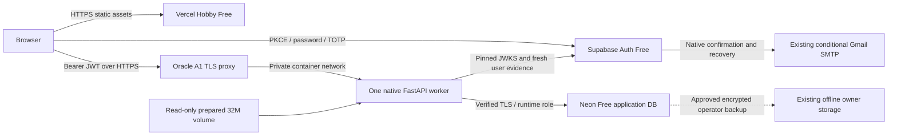

# Proposed production hosting blueprint — NOT execution approval

**HISTORICAL Oracle selection, superseded November16,2026.** Current selection is
existing Azure/Vercel/Neon/Supabase; Azure stays stopped. Follow
[Azure preparation](AZURE_NATIVE_DEPLOYMENT.md), not the old deployment steps below.

2026-11-15; source baseline `f054300` (merged PR91–110). Read the measured
[evaluation and source register](ZERO_COST_HOSTING_EVALUATION.md) first. No target,
account, migration, DNS, credential or deployment is approved by this document.
The objective is public native signup/confirmation/profile/TOTP/ratings/recommendations,
not local staging as the owner's final experience. Production remains NOT READY.

## Owner-selected architecture A — preparation only

Vercel serves only the approved native static build; no Vercel gateway or private gate
is required. API JWT/ownership policy protects personal operations; anonymous reads
stay public. Do not expose legacy routes or co-route them. Confirm Hobby noncommercial
eligibility, hard pause/usage behavior, and public-protection/auto-promotion settings.
Cloudflare Pages remains a free static fallback, not the selected deployment.

## Resource and no-overage contract (all unverified targets)

| Component | Proposed minimum / required proof before execution |
|---|---|
| Oracle account | Owner's single eligible **non-paid** tenancy; no PAYG, trial-credit-only SKU, upgrade automation or saved paid fallback. Verify home-region available A1, exact Always Free labels, remaining account-wide quotas and charge terms privately. Card verification may place a temporary hold. Lack of capacity means STOP, not upgrade. |
| VM | Estimate one 1–2 OCPU/4 GiB+ A1, within total2 OCPU/12 GB. API initial limit2 GiB, one worker, finite PIDs/CPU/file descriptors; reserve RAM for Linux/proxy/readiness child/cache. Linux ARM image/wheel/cold-start/OOM measurements required. No auto replicas. Idle reclaim is accepted only by explicit owner decision; do not generate fake utilization. |
| Disk | Eligible50GB boot volume is ample estimate; total boot/block≤200GB and backup count≤5. Immutable≈515 MiB reference plus≥2 GiB preparation/extract space, OS/images/rotated logs; measure actual image size and raw preprocessing separately. Never put live ratings solely on ephemeral container storage. |
| Network | VM ingress443;80 only HTTP-01 challenge/redirect; SSH restricted to approved operator source, no public8000/PostgreSQL. Direct eligible public IP; no managed LB, NAT gateway or paid DNS/flow-log add-on. Verify egress/public-IP meters and account-wide10TB allowance; no PAYG overage. |
| Static host | Existing Vercel **Hobby**, native static build only, vercel.app HTTPS, no paid add-ons/functions; verify noncommercial eligibility, exact usage caps, current protection and automatic promotion before approval. Public hostname TBD. Cloudflare Pages Free is fallback only. |
| Database | Existing Neon Free, intended target TBD after owner inspection/isolation decision. Check compute/egress/storage/branches across the project, not just current37MB historical storage. Keep5min scale-to-zero; refuse at quotas, never upgrade. Encrypted dumps on approved existing storage, restore rehearsal and retention required. |
| Auth/email | Supabase Free, intended production project/root TBD; preserve dev separation within two-project allowance. Conditional existing Gmail SMTP only; no paid sender/custom Auth domain/SMS. Confirm email delivery/recovery/rate limits/abuse protection before signup exposure. |
| CI/registry | Prefer local approved ARM build or standard public-repo Linux CI; no larger/paid ARM runner. [Actions compute][actions] is free on standard public runners; artifacts/caches need separate budget review. [Public packages][packages] are free; verify GHCR visibility/terms or transfer reviewed image offline. No image publication is authorized here. |

Never infer free capacity from student credits, forecasts, billing alerts, min0,
max1, access protection, a quota warning, or an invoice of0. Check each ancillary
meter; disable new usage rather than authorize costs. Free suspension/reclaim can
break login/recommendations. Do not promise a production SLA. Existing Azure
resources remain untouched; their baseline cost is outside this proposed stack.

## Exact configuration contract — names/categories only

| Scope | Required names / values to approve privately |
|---|---|
| Reviewed nonsecret manifest | `MOVELLE_NATIVE_TARGETS_FILE`: `approved:true` only AFTER approval, exact `frontend_origin`, distinct exact `api_origin`, root `supabase_url`, exact Neon `database_host`/`database_name`. Until then use no approved manifest. Never publish DB credentials. |
| Native server | `APP_ENV=production`, `MOVELLE_NATIVE_MODE=native-release`, `MOVELLE_NATIVE_PREPARED_DIR`, `MOVELLE_NATIVE_PUBLISHABLE_KEY`, `MOVELLE_NATIVE_DATABASE_URL`, `CORS_ALLOWED_ORIGINS` exactly frontend origin, `PORT=8000`. Dedicated `movelle_native` DB user; exact `sslmode=verify-full&sslrootcert=system&channel_binding=require`. No ambient `PG*` overrides or `TRUSTED_PROXY_IPS`. |
| Native browser build | `MOVELLE_NATIVE_TARGETS_FILE`, `MOVELLE_NATIVE_PUBLISHABLE_KEY`; `npm ci`, `npm run build:native`, publish ONLY `dist-native`. Build embeds public origin/Auth/key fields, excludes DB data. Never substitute `VITE_API_BASE_URL`/normal legacy build or staging test providers. |
| Supabase owner settings | Explicit project/ES256 key readiness, Confirm Email, native recovery/email-change/TOTP settings, exact Site URL and redirect allowlist entries. Approve root `FRONTEND_ORIGIN_TBD/` for production; development remains `http://127.0.0.1:5173/`. Preview origins are individually TBD, no wildcard. Gmail SMTP secret remains provider-side. |
| Host/proxy | Reviewed image digest, reference manifest/digest, ACME email/account key and TLS private key only on host; operator SSH key distinct from runtime. No cloud-account token inside app container. New deletion signing/admin credentials are neither required nor supplied. |

JWT issuer is exact approved Supabase root +`/auth/v1`, audience `authenticated`,
trusted project-pinned JWKS/ES256 only. No token-provided URL or publishable-key
HMAC. Existing provider-current email/factors policy, signed AAL2 for enrolled TOTP,
UUID→numeric ownership, group consent, body/CPU/DB/rate limits remain mandatory.
Unknown evidence/outages deny; standard bounded token validity is not immediate
revocation. No legacy linking/fallback or email-only MFA bypass is introduced.

## Container, TLS and frontend delivery preparation

Prepare a reviewed alternate native image/Compose file, not a production CMD edit:
hash-locked Python 3.14 dependencies, non-root UID10001, explicit native command,
read-only root filesystem/reference mount, bounded tmp/cache, no Docker socket or
host privileges. Build/verify artifacts offline; retain GroupLens attribution and
public redistribution permission gate. No install/download/migration per request.

Use a pinned maintained TLS proxy (e.g. Nginx) on the VM; API reachable only on
its private Compose network. Keep current Uvicorn forwarded-header trust disabled.
Consequently source-IP limits initially aggregate at the proxy address: conservative
but restrictive. Any real-client-IP trust needs a separate exact-hop anti-spoofing
review/test; never enable wildcard forwarding to improve capacity.

Public backend origin needs neither a paid domain nor untrusted TLS. Options:
an already controlled no-new-cost DNS name, OR exact stable assigned IP with
[Let's Encrypt's supported six-day IP certificates][ipcert]. Certbot≥5.4 supports
webroot/IP issuance; installation and reload hooks must be configured/tested.
Do not assume proxy auto-TLS supports IPs. Verify automatic renew/reload, clock,
browser/CORS/SDK compatibility, firewall80 and expiry alerts before acceptance.
IP replacement requires new certificate/manifest/frontend approval. DNS/IP TBD;
no guessed hostname, self-signed certificate, tunnel or DNS purchase is approved.

Vercel serves the existing root callback/SPA; fallback must not rewrite missing assets
as JavaScript. Retain/review existing Vercel security headers: exact `connect-src`
API/Auth, required artwork `img-src`, no
framing, nosniff, appropriate referrer policy (prefer no-referrer on callbacks).
Keep callback URL scrubbing and fixed destination. TLS terminators necessarily
receive callback queries; review provider log retention/access, disable application
URL/body/header logs and analytics, and never send codes/tokens to error reporters.
No caching personal API replies; preserve no-store. Static hashed assets can cache.

## Health, persistence, deployment and rollback

1. Routine liveness: `/health`/local process/TCP, not periodic DB `/ready`. Use
   `/ready` for explicit deployment and bounded incident checks. Current30s readiness
   cache still queries Neon if polled; constant queries at0.25CU can use182.5CU-h/month
   versus100 free. Test actual idle/reconnect behavior,3s probe deadline and CU usage.
2. Retain immutable reference/versioned image, ACME state and bounded logs/cache.
   Neon holds user records, not reference arrays; pooling remains2/overflow 0. Review
   least-privilege runtime versus migration/backup roles and verified TLS/CA rotation.
3. Approve backups separately: encrypted app dumps to existing owner storage, with
   retention/key custody and restore in disposable schema. Limited provider restore
   windows are not sufficient alone. Supabase Free identity recoverability and
   dependency outages remain operational gaps; do not claim Auth backup coverage.
4. After explicit future authority only: inspect live schema, rehearse additive
   schema 4 migration/restore, publish digest, start API without public promotion,
   test ready/native-only negative paths, then coordinate frontend/API cutover.
   Retire old unauthenticated API revisions; no mixed traffic, legacy fallback or
   client-selectable authentication. Existing Azure dispatch is hardcoded production;
   do not reuse it for OCI. Main Vercel auto-promotion needs an approved hold first.
5. Roll back code to a reviewed native/schema 4-compatible digest and paired frontend
   manifest; no blind reverse migration, DB reset, lost ratings or legacy binary.
   On unknown outcomes serve maintenance/deny writes. Record manual stop/recovery
   ownership and test reboot, VM reclaim recovery, storage-full and expired TLS.
6. Observability: finite rotating redacted logs, health/latency/error/CPU/RSS/disk,
   Neon CU/storage/egress and SMTP quota reviews, certificate expiry and provider
   status. No paid exporter/ingestion or synthetic Auth keepalives. Short local
   logs imply limited forensic retention; document gaps in the security assessment.

## Prioritized preparation roadmap (each future PR≤500 changed lines)

| Order | Independent review boundary / acceptance |
|---|---|
|1 | Owner selects A/free-only downtime policy; privately confirms OCI eligibility/capacity and each existing account's caps. Approve exact origins/projects/DB isolation. No resource creation implied. |
|2 | Alternate native ARM64 image/Compose packaging with offline pinned32M; Linux RSS/cold/warm/CPU/deadline/OOM/disk measurements and no legacy route/dependency fallback tests. No deployment workflow activation. |
|3 | Proxy/ACME-IP or existing-DNS TLS, firewall, reboot/renewal/log redaction and liveness configuration; static Vercel headers/fallback/native-build checks. Test account-switch/callback URLs and hostile forwarded headers offline. |
|4 | Separately authorized schema 4/grants/backup/restore and exact-target rehearsal. Preserve numeric IDs/relationships; no claim/link of legacy profiles. Establish actual Neon duty-cycle/quotas or review Aiven migration as another decision. |
|5 | Owner-authorized new bounded genuine-provider acceptance: public-origin signup→confirmation→profile→first/backup TOTP→AAL2→ratings/recommendations/groups/logout; settings/recovery replay/account switching and mail placement. Existing10/10 campaign budget cannot be reused. |
|6 | Resolve [account-operation gates](ACCOUNT_OPERATIONS_READINESS.md) independently. Keep removal/opt-out and deletion disabled until their policy/provider/isolated-worker/DDL/retention gates pass; do not advertise them as live. |
|7 | Complete full NIST SP800-63B-4 controls/evidence/gaps and original16-stage professional audit, load/restore/incident/legal review and owner release approval; then a separate deployment authorization. No compliance claim follows from this blueprint. |

**Next owner decision:** select architecture A with non-paid-only/no-upgrade policy
and explicit acceptance of free-tier suspension/reclaim downtime, or decline it.
Selection authorizes further preparation only; execution/production activation
requires all gates and a separate approval. No final production audit starts here.

[actions]: https://docs.github.com/en/billing/concepts/product-billing/github-actions
[packages]: https://docs.github.com/en/packages/learn-github-packages/introduction-to-github-packages
[ipcert]: https://letsencrypt.org/2026/03/11/shorter-certs-certbot
